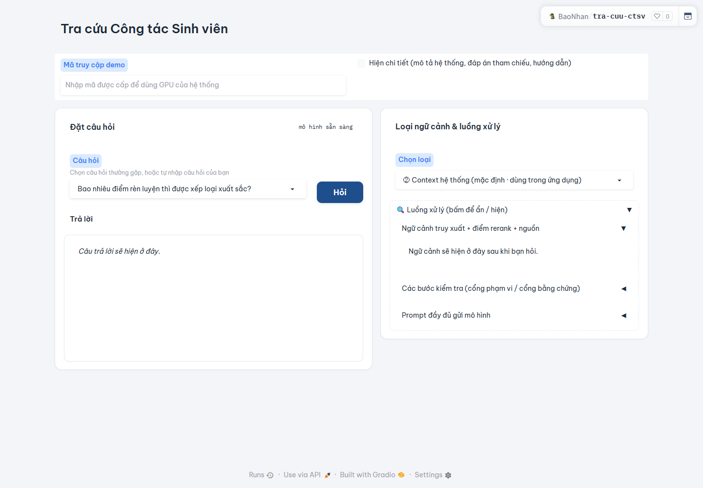
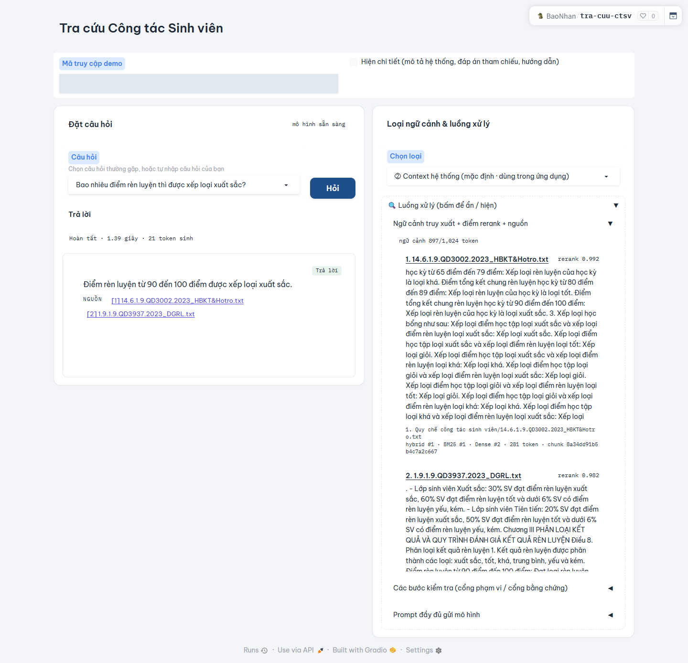
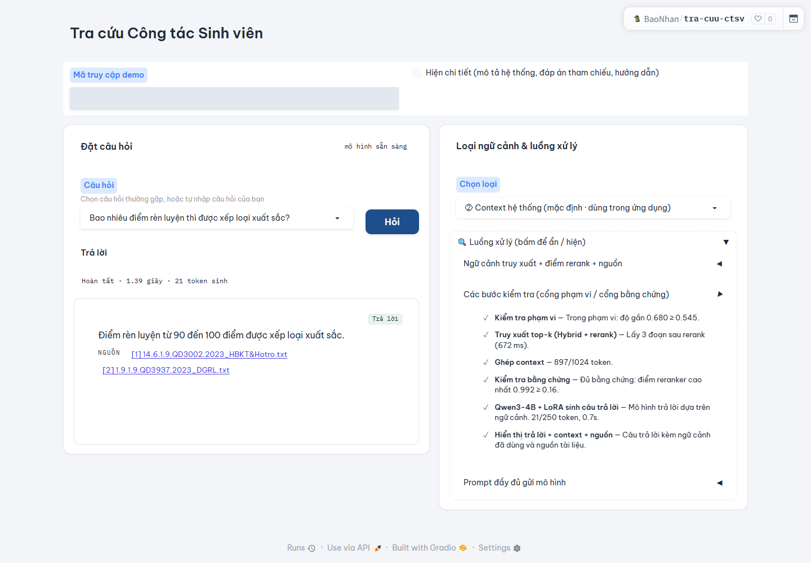

# ViSAQA

**Tiếng Việt** | [English](README.en.md)

**Đánh giá tính đầy đủ của bằng chứng và khả năng nhận biết phạm vi trong hỏi đáp công tác sinh viên bằng tiếng Việt**

Tên bài báo: *ViSAQA: Benchmarking Evidence Sufficiency and Scope Awareness in Vietnamese Student Affairs Question Answering*

Huu Dung Nguyen · Phuoc Tran · Van Thinh Nguyen · Bao Nhan Chau · Hoang Kiet Duong · Van Dung Nguyen

Bài báo đã được chấp nhận tại [Hội nghị quốc tế EAI lần thứ 6 về Trí tuệ nhân tạo cho Truyền thông và Mạng (EAI AICON 2026)](https://aicon-conf.eai-conferences.org/2026/). **Trạng thái xuất bản trong kỷ yếu: To Appear.**

[Trải nghiệm ứng dụng](https://huggingface.co/spaces/BaoNhan/tra-cuu-ctsv) · [Trích dẫn](#trích-dẫn)

## Giới thiệu

ViSAQA nghiên cứu bài toán hỏi đáp công tác sinh viên bằng tiếng Việt, tập trung vào tính đầy đủ của bằng chứng và khả năng nhận biết câu hỏi ngoài phạm vi. Bộ đánh giá gồm **15.879 mẫu thuộc 21 chủ đề**, với ba nhóm: có thể trả lời, không đủ thông tin và ngoài phạm vi. Nghiên cứu đánh giá riêng chất lượng truy xuất, chất lượng câu trả lời trên các câu có đáp án và hành vi từ chối, với hai cách chia dữ liệu: tách biệt theo chủ đề và chia ngẫu nhiên.

Bài báo đánh giá ViT5, BARTpho, mBART, mT5-base và mT5-small trong các điều kiện chỉ có câu hỏi, BM25, truy xuất dense và truy xuất hybrid. Hiệu quả của truy xuất phụ thuộc vào mô hình và cách chia dữ liệu; điểm tổng hợp có thể che khuất việc từ chối quá mức hoặc trả lời thiếu căn cứ.

## Ứng dụng minh họa

Ứng dụng [Tra cứu Công tác Sinh viên](https://huggingface.co/spaces/BaoNhan/tra-cuu-ctsv) cung cấp giao diện tiếng Việt để đặt câu hỏi, xem câu trả lời và kiểm tra các đoạn ngữ cảnh cùng nguồn tài liệu được truy xuất.

**Cấu hình demo:** ứng dụng đang triển khai hiển thị mô hình sinh **Qwen3-4B + LoRA (seed 42)** và bộ truy xuất **Hybrid BM25 + BGE-M3, kết hợp reranking và chọn top-3**, cùng các bước kiểm tra phạm vi và bằng chứng. Cấu hình ứng dụng khác với các thí nghiệm sequence-to-sequence trong bài báo. Các ảnh dưới đây minh họa luồng sử dụng ứng dụng, không phải kết quả đánh giá benchmark.

### Thử một câu hỏi

1. Mở ứng dụng và nhập mã do chủ demo cung cấp vào ô **Mã truy cập demo**.
2. Chọn hoặc nhập câu hỏi bên dưới vào ô **Câu hỏi**.
3. Giữ lựa chọn **Context hệ thống (mặc định · dùng trong ứng dụng)** và nhấn **Hỏi**.
4. Đọc phần **Trả lời**, sau đó xem **Ngữ cảnh truy xuất + điểm rerank + nguồn** và **Các bước kiểm tra (cổng phạm vi / cổng bằng chứng)**.

> Bao nhiêu điểm rèn luyện thì được xếp loại xuất sắc?

**Câu trả lời thực tế trong lượt chạy minh họa:**

> Điểm rèn luyện từ 90 đến 100 điểm được xếp loại xuất sắc.

Câu trả lời dẫn hai nguồn `14.6.1.9.QD3002.2023_HBKT&Hotro.txt` và `1.9.1.9.QD3937.2023_DGRL.txt`. Ứng dụng truy xuất ba đoạn và sử dụng 897 token ngữ cảnh. Đây là một ví dụ quan sát được, không phải ước lượng độ chính xác của hệ thống.

### 1. Nhập câu hỏi



### 2. Xem câu trả lời và nguồn tài liệu



### 3. Kiểm tra luồng xử lý và bằng chứng



Ảnh được chụp trực tiếp từ ứng dụng ngày **30/10/2026**. Ô mã truy cập đã được che trong các ảnh sau khi nhập mã. Kết quả và thời gian xử lý có thể thay đổi theo mô hình và tập tài liệu đang triển khai.

## Nội dung repository

Repository hiện có tài liệu giới thiệu song ngữ, ảnh minh họa ứng dụng và thông tin trích dẫn. Mã nguồn triển khai chưa được bổ sung. Bản PDF bài báo và các tệp kỷ yếu không nằm trong repository.

## Trích dẫn

Trạng thái xuất bản: **To Appear**. DOI, số tập và số trang sẽ được bổ sung khi kỷ yếu xuất bản.

```bibtex
@inproceedings{nguyen2026visaqa,
  author    = {Nguyen, Huu Dung and Tran, Phuoc and Nguyen, Van Thinh and Chau, Bao Nhan and Duong, Hoang Kiet and Nguyen, Van Dung},
  title     = {{ViSAQA}: Benchmarking Evidence Sufficiency and Scope Awareness in Vietnamese Student Affairs Question Answering},
  booktitle = {Proceedings of the 6th EAI International Conference on Artificial Intelligence for Communications and Networks (EAI AICON)},
  year      = {2026},
  note      = {To Appear}
}
```

Thông tin này cũng có trong tệp [CITATION.bib](CITATION.bib).
